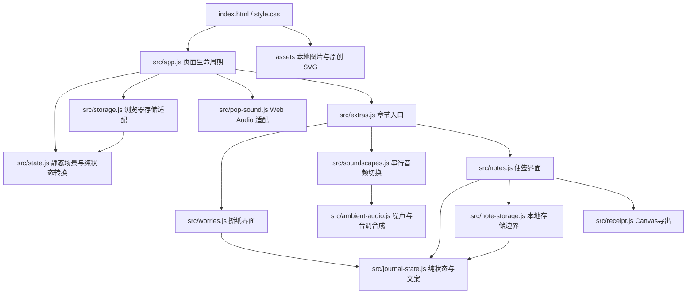

# 页面结构

不依赖框架、CDN、API Key、后端或第三方运行包。app 初始化闭包承载页面状态，状态转换独立测试，故障由浏览器能力边界返回并统一展示。所有相对资源路径适用于 GitHub Pages 仓库子路径部署。

地标素材由 src/landmarks.js 单独维护，app.js 读取展示元数据；state.js 保存场景内容和 artwork 关联键。线稿、插画和照片均在 assets/ 内，未引入图片服务或构建依赖。

state.js 中的 region、themes、start 和 duration 是静态场景内容；地区与兴趣选择保存在页面内存中，app.js 依据它们显示现有泡泡。短路线和口袋查看详情复用原场景卡。部分 LANDMARKS 条目引用本地照片和署名元数据，页面仅在访客点击来源链接时离开站点。
